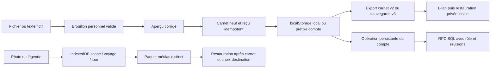

# Données, imports et assistant — examen des sources

Référence : 6e319457ec9f20fe5720979640e950b7a4c0dccc. Date : 31 octobre 2026, Asia/Shanghai. Périmètre : volets 4 et 6 du plan, compléments du volet 2. Lecture des sources et tests existants ; aucun serveur ni test lancé par ce sous-audit. Les résultats du coordinateur sont dans VALIDATION.md. Aucun défaut fonctionnel n'est déclaré reproduit par cette seule lecture.

## Flux et stockage

| Donnée | Stockage / isolation | Synchronisation et droits | Export et récupération |
|---|---|---|---|
| Carnet local | a-l-est-trip-v2:ID ; journeys.ts:9-40 | Pas de compte requis | Export trip/collection v2 ; v3 ; copie récupération avant écriture |
| Carnet connecté | AccountStorage préfixe detours-account-v1:accountId ; storage.ts:21-65 | État + pending + operation dans une écriture relue ; rôle reader interdit côté cache ; décision serveur via RPC | Cache téléchargé exportable ; ni session ni droits restaurés |
| Notes/réservations/budget/documents/préparation | Champs du carnet et projection commune/personnelle | Champs partagés selon membre ; merge SQL des catégories autorisées | Embarqués dans carnet ; restauration privée ne récupère pas les droits serveur |
| Mon monde | WORLD_KEY dans stockage local ou espace compte | Visites et participations identifiées séparément des copies/imports de carnets | V3 remappe journeyId/stayId et fusionne visites ; export Mon monde séparé existant |
| Brouillon import | DRAFT_KEY à travers stockage personnel | checkScope à la lecture/écriture ; pas de sync du brouillon | Source et origine texte conservées ; preparedTrip puis reçu ; reprise sans nouveau carnet |
| Photos/légendes quotidiennes | IndexedDB detours-personal-souvenirs-v1 ; clé JSON [scope,trip,day] | Privées, hors synchronisation/carnet commun | Exclues v3/v2 ; paquet médias v1 jusqu'à 48 Mio ; jours absents/existants ignorés |
| Préférences interface | Stockage appareil ; distinction préférences personnelles | Langue/apparence et choix mascotte ne constituent pas un contenu commun du carnet | V3 conserve préférences existantes ; ne restaure ni session ni rôle |
| Journal restauration | RESTORE_PREFIX + SHA256 fichier | Local au navigateur ; verrou detours-restore et WORLD_KEY dans BackupPanel | Même fichier requis ; écritures partielles visibles ; reçu empêche doublon |
| Sources illisibles anciennes | Clés de récupération et SOURCE_PREFIX | Ne remplacent pas une clé active | Téléchargeables ; pas de conversion automatique en carnet vide |

## Invariants réellement visibles

1. **Validation et relecture.** journeys.ts:22-40 valide le carnet avant écriture et le relit. travel-write.ts:8-19 sauvegarde l'ancienne valeur en récupération, relit cette copie, puis écrit le carnet. Une seule copie précédente n'est pas un historique illimité.
2. **Restauration déterministe.** backup.ts:162-216 dérive un ID de fichier et les identités restored-ID-index, reconstitue le plan depuis les états avant restauration, refuse plusieurs journaux concurrents et des carnets déjà présents à l'identité cible. backup.ts:219-253 précontrôle les originaux, écrit/re lit le journal, vérifie chaque valeur avant écriture et relit chaque écriture. Un échec de quota peut laisser un sous-ensemble visible ; ce n'est pas atomique et le code ne le prétend pas.
3. **Import à reçu.** planning-import/persistence.ts:41-83 contrôle scope et session, détecte un brouillon modifié dans un autre onglet, persiste le candidat exact avant carnet puis reçu. createLocalTrip conserve un carnet importé en espace compte sans lancement automatique de sync. Rejouer un candidat déjà écrit relit son contenu au lieu de doubler la création.
4. **Photos transactionnelles.** souvenirs.ts:96-134 utilise une transaction IndexedDB readwrite unique, vérifie révision attendue et budget global, puis relit révision et taille. L'abandon de transaction conserve la valeur précédente. Les limites sont 12 Mio source, 32 Mpx, 1600 px final, 512 Kio par copie, 32 Mio et 1000 entrées globaux ; ces bornes ne garantissent pas le quota réel du navigateur.
5. **Paquet sans écrasement.** souvenirs.ts:157-183 valide taille/structure/base64/hash, réencode les photos entrantes et ignore les journées absentes ou déjà pourvues. Les sources originales ne sont pas modifiées. Une journée supprimée reste récupérable dans le paquet d'origine, sans être recréée automatiquement.
6. **Droits serveur.** 202610060001_detours.sql:69-80 active RLS, restreint les grants aux lectures attendues, garde mutations derrière RPC. La version du save_trip dans 202610090001_day_preparation.sql:147-176 verrouille la ligne, recontrôle rôle/revisions et merge les catégories autorisées. Le fait que SECURITY DEFINER existe n'est pas en soi une vulnérabilité ; search_path, auth et grants doivent être suivis ensemble. Déploiement effectif, PostgREST et révocation concurrente réels non établis par ces lignes.

Les critères grants + politiques sont cohérents avec la [documentation RLS officielle](https://supabase.com/docs/guides/database/postgres/row-level-security), consultée durant l'audit. La tentative de lecture de https://supabase.com/changelog.md a échoué dans l'outil web (content-type text/markdown non pris en charge) : pas de revue complète du changelog revendiquée et aucune modification Supabase effectuée.

## Matrice formats × cas

Le résultat ci-dessous décrit le comportement prévu par le chemin source et la couverture existante, **pas un résultat dynamique nouveau**. Corpus fictif disponible sous tests/fixtures/planning/ : corpus.mjs, stress-corpus.mjs, lot06-corpus.json et documents/.

| Format / cas | Chemin et bornes inspectés | Résultat source attendu / contrôle disponible | État audit |
|---|---|---|---|
| TXT/MD propre/multilingue | files.ts:3-44 ; parser.ts ; 200000 octets, 50000 caractères | UTF-8 fatal ; aperçu corrigible ; planning-files.test.mjs et planning-parser.test.mjs | Lecture ; exécution déléguée au coordinateur |
| Bruit, sans dates, villes multiples, alternatives, négation réservation | booking.ts, review.ts, draft.ts ; corpus.mjs et stress-corpus.mjs | Provenance et avertissements ; aucune confirmation supposée à partir d'hôtel estimé ; fidélité à mesurer, pas seulement JSON | Non mesuré sur corpus nouveau |
| PDF texte | documents.ts:3-55 ; document-pdf.ts ; 10 Mio/50 pages/50000 caractères/20 s | Modules différés, contrôle signature, extraction locale ; fixtures simple/chinese/columns/table | Lecture ; rendu et ordre de texte à recetter |
| PDF scan/protégé/51 pages/trop long/corrompu | document-contract.ts ; documents/scan.pdf, protected.pdf, pages-51.pdf, long.pdf, corrupt.pdf | Refus explicite sans OCR/troncature ; document précédent conservé dans interface selon contrats | Pas de rejeu ici |
| DOCX | documents.ts ; document-docx.ts ; docx.worker.ts | Worker annulable ; 1000 entrées ZIP, 20 Mio décompressés, 2 Mio/XML ; aucune macro DOCM prise en charge | Lecture ; pas d'exécution d'archives hostiles |
| DOCX fake/entités/bombe/tailles forgées | fixtures active.docx, entity.docx, zip-bomb.docx, forged-size.docx | Tests planning-documents.test.mjs disponibles ; contrôles taille réelle requis au parseur | À rattacher au résultat actuel des tests, pas une preuve sécurité autonome |
| JSON detours-planning v1 | public-contract.ts:5,92-137 ; structured.ts | Champs inconnus/structure/bornes contrôlés ; 200000 octets/50000 caractères/profondeur 12/100 jours/200 items | Présent ; fidélité sémantique non certifiée |
| JSON IA quatre langues | public/import-kit/{racine,en,zh-CN,es} ; schéma et exemples ; import-kit.ts | Même contrat public ; tests exemples/kit existants | Alignement sémantique intégral des quatre textes non relu ici ; reste à valider |
| Ancien export v1/v2 | journeys.ts:113 ; backup.ts:94-108 | Import copie historique 5 Mo ; restauration v3 accepte v1/v2 jusqu'à 64M octets | Chemins distincts présents ; chaîne navigateur complète non exécutée ici |
| V3 gros volume/interruption/conflit | backup.ts:162-253 ; tests/backup.test.mjs ; full-backup.spec.ts | Conservation sources, mapping stable, reprise original, refus modification concurrente | Lecture ; limites quota dépendantes environnement |
| Import interrompu, double confirmation, autre compte | persistence.ts:12,41-83 ; planning-lot01.test.mjs | checkScope ; candidat durable ; refus brouillon divergent ; reçu idempotent | Invariants source examinés ; pas de vrai basculement compte |
| Paquet photos/légendes | souvenirs.ts:140-183 ; tests/souvenirs.test.mjs ; souvenirs.spec.ts | Carnet d'abord ; destination choisie ; préexistants/jours absents ignorés ; quota et conflit transactionnels | Lecture ; chaîne navigateur à rattacher à VALIDATION |

## Assistant : pouvoirs et limites

assistant.ts:6-30 expose exactement note, field, move, lighten. prepareAssistant valide l'entrée, clone avant/après et refuse changements invalides. Un déplacement d'activité réservée ou dépendant d'une préparation est refusé (lignes 63-69). Un allègement conserve réservations et activité ancre. searchNotebook (ligne 80+) est une recherche locale littérale ; le texte importé est traité comme contenu.

travel-write.ts:23-42 reconstitue la proposition, recontrôle scope, rôle, révocation/conflit et catégorie, compare révision complète et détecte une écriture déjà appliquée. useTravelState.ts:97-124 prend le même Web Lock que les formulaires et refuse l'assistant sans navigator.locks. Aperçu, application et annulation sont des actions contrôlées ; le code ne constitue pas une API d'outils pour un modèle général.

**Point à vérifier D-NV-01 (sans priorité de bug).** Les formulaires ordinaires ont un fallback sans verrou si navigator.locks.request échoue (useTravelState.ts:92), tandis que l'assistant échoue fermé. Le fallback est une différence de contrat à documenter/tester avec deux onglets et navigateur sans Web Locks. Une perte de données n'est pas démontrée : le callback synchrone relit/merge les dernières valeurs et possède ses propres catches. Preuve décisive : deux profils même origine et rendez-vous contrôlé, refus du verrou, écritures concurrentes sur même champ et champs indépendants ; comparer stockage, export affiché et copie de récupération. Correction seulement si un scénario démontre une violation.

**Point à vérifier D-NV-02 (sans priorité de bug).** La révocation ou restriction côté compte avant écriture locale est vérifiée pour l'assistant ; une révocation serveur inconnue hors ligne ne peut pas être devinée. Tester ensuite le refus RPC et le maintien d'une copie exportable lors de la reconnexion. Ne pas considérer une modification de cache personnel comme preuve d'une écriture serveur non autorisée.

## Lieux, cartes et contrats serveur

Les liens Google/Amap ne sont pas un flux d'avis Google ni une garantie de bonne adresse. L'association Wikidata/Commons reste facultative ; vérifications d'attribution, réseau, absence de coordonnées inventées et recours hors ligne relèvent de la recette du volet UX/lieux. Ces services n'ont pas été interrogés par ce sous-audit.

extraction.ts:10-30 contient un vrai contrat client d'extraction, conditionné par VITE_PLANNING_EXTRACTION_ENABLED, jeton et endpoint /api/planning-extraction ; résultat validé contre source, réponse bornée à 1M octets et timeout 45 s. Sa présence doit être distinguée des benchmarks NVIDIA. La configuration réelle du serveur déployé n'a pas été inspectée ici ; aucune activation ni disponibilité n'est inférée.

## Décision benchmarks

- **06 local : garder l'expérience négative, reporter tout autre candidat.** Rapport actuel lot-06-modele/RAPPORT.md:3,37 : NE PAS INTÉGRER. Source historique : 0/12 propositions modèle acceptées, aucune amélioration hybride, latence et poids hors budgets. Aucun nouveau téléchargement ou appel lancé.
- **06 bis : garder le protocole et les données, retester uniquement sur critère choisi.** ESSAI-MINIMAX.md:11-37 : 12 tentatives, 10 réponses, deux 429 dont injection ; 6/12 sorties acceptées, 17/31 activités après garde-fous, médiane 6,88 s sur réponses reçues. Critère avant retest : gain d'activités correctement rattachées après les mêmes contrôles, zéro réservation injustifiée, corpus injection réellement répondu, coût et effort de correction mesurés. Aucun coût ou gratuité future déduit de ces résultats. Pas de relance dans l'audit.
- **Kit externe et règles : garder.** Ils permettent le mode local et une relecture de provenance. L'alternative la plus simple reste correction manuelle de l'aperçu ; le JSON valide ne suffit pas à prouver une extraction fidèle.

## Scénarios de non-régression et recette manquante

1. Export ancien v1 multilingue → import → correction adresse/notes/réservation → export v2/v3 → profil vierge → restauration ; comparer tous champs, documents et relations hors remapping voyage explicite. Répéter après interruption et vérifier absence doublon.
2. Restaurer carnet à ID changé, puis paquet médias : jour connu vide ajouté, préexistant conservé, supprimé compté ignoré ; comparer JPEG/légende et conserver paquet original. Rejouer quota faible puis reprise.
3. Deux onglets : modifications indépendantes conservées, même champ signalé selon merge ; assistant en attente de verrou puis révision modifiée ; ancien aperçu refusé et nouvelle source récupérable. Annulation après édition tierce refusée.
4. Deux comptes réels autorisés : propriétaire/éditeur/lecteur ; périmètre par catégorie ; invitation expirée/révoquée ; changement droits après préparation avant RPC ; carnet retiré pendant hors ligne puis reconnecté ; pas de contenu du compte A visible dans B. Tests réels non exécutés ici.
5. Corpus fictif import : pour chaque format, compter activités attendues/retrouvées/bien rattachées, omissions, créations indues, confirmations inventées et temps humain. Aucun score neuf n'a été calculé pendant cette inspection.

## Skills lus et application

| Skill lu | Étape | Règle appliquée | Preuve / limite |
|---|---|---|---|
| systematic-debugging | 4,6 | Tracer les sources, séparer hypothèse et reproduction, pas de correctif sans cause | D-NV-01/02 restent hypothèses ; aucun test ni changement produit |
| supabase:supabase | 4 | Contrôles serveur distincts du client ; lire grants/RLS/RPC ensemble ; vérifier documentation actuelle | Migrations et docs RLS consultées ; changelog non accessible via outil ; zéro mutation distante |
| supabase-postgres-best-practices + references/security-rls-basics.md + lock-short-transactions.md | 4,8 | Isolation multi-tenant côté SQL, durée/périmètre des verrous | Ligne FOR UPDATE et contrôles de rôle examinés ; aucun EXPLAIN/coût distant mesuré ; pas de proposition d'index spéculative |

## État de couverture honnête

Ce volet fournit une revue source des invariants principaux et une carte des contrôles disponibles. Il ne remplace ni le gate, ni l'audit sécurité indépendant, ni une recette complète de tous les formats et volumes demandés. Chaîne complète migration/import/export/restauration, corpus métier neuf, alignement exhaustif des quatre langues, droits distants réels et médias sur appareil restent non vérifiés ici. Les résultats du coordinateur peuvent lever certaines de ces limites, uniquement lorsqu'un scénario exécuté correspond exactement.
